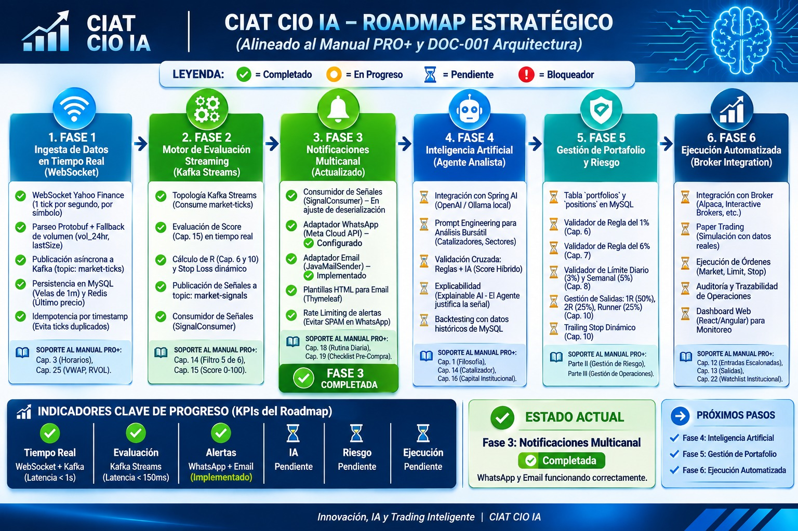
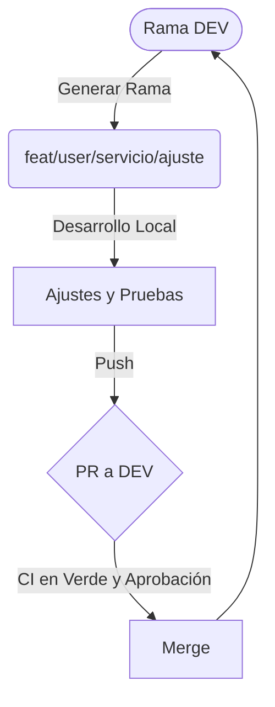

# 🏛️ CIAT-CIO-AI PRO+ (Digital CIO)

**Digital CIO – Chief Investment Officer Digital con Inteligencia Artificial**

> *"Invertir sin emoción, con inteligencia algorítmica, dentro de un marco regulatorio sólido y con seguridad como pilar tecnológico."*

Bienvenido al repositorio oficial de **CIAT-CIO-AI**. Este proyecto implementa un modelo operativo de tipo *Hedge Fund* para el trading algorítmico y la gestión de portafolios, combinando metodologías de trading probadas con una arquitectura de microservicios de alto rendimiento, procesamiento de streams en tiempo real y gestión de riesgo institucional.

---
**Repositorio de Ingeniería y Arquitectura de Software**

Este repositorio contiene el código fuente y la documentación técnica del sistema **CIAT-CIO-AI**, una plataforma de trading algorítmico basada en microservicios orientados a eventos (EDA). El sistema está diseñado para procesar flujos de datos de mercado, calcular indicadores técnicos y ejecutar estrategias de gestión de riesgo institucional.

Este documento está dirigido a **Arquitectos de Software, SREs, Ingenieros de Datos y Desarrolladores Backend**.

---

## 📑 Índice de Navegación

1. [01 - Adopción (Domain-Driven Design)](#01---adopción-domain-driven-design)
2. [02 - Análisis (Requerimientos del Sistema)](#02---análisis-requerimientos-del-sistema)
3. [03 - Arquitectura (Topología y EDA)](#03---arquitectura-topología-y-eda)
4. [04 - Diseño (Modelo de Datos y Algoritmos)](#04---diseño-modelo-de-datos-y-algoritmos)
5. [05 - Implementación (Stack y CI/CD)](#05---implementación-stack-y-cicd)
6. [06 - Optimización (Performance y Resiliencia)](#06---optimización-performance-y-resiliencia)
7. [07 - Cierre (Observabilidad y Contacto)](#07---cierre-observabilidad-y-contacto)
8. [08 - Estrategia de Versionado (Git Flow)](#08---estrategia-de-versionado-git-flow)

---

## 01 - Adopción (Domain-Driven Design)

**Objetivo:** Definir el *Bounded Context* y las reglas de negocio que el software debe modelar.

*   **Core Domain:** Ejecución de estrategias de *momentum* y gestión de riesgo basada en unidades de riesgo (R-Multiples).
*   **Reglas de Dominio Invariables:**
    *   **Filtro Eliminatorio:** Validación de integridad de datos para evitar *splits* inversos no ajustados.
    *   **Scoring Algorithm:** Evaluación de instrumentos sobre 100 puntos. Umbral: `Score >= 70`.
    *   **Gestión de Exposición:** Límite de riesgo del 1% por operación y 6% total.
*   **Timezones & Session Management:** El motor de reglas opera estrictamente bajo la zona horaria `America/New_York`, manejando el *Daylight Saving Time (DST)*.

| Documento / Entregable | Ubicación en el Repo | Propósito |
| :--- | :--- | :--- |
| **Manual PRO+ v2.1** | `/01-Adopcion/MANUAL_PROFESIONAL...txt` | Reglas de negocio, Cap. 1 al 25. |
| **Glosario Técnico** | `/01-Adopcion/GLOSARIO.md` | Definición de RVOL, VWAP, R-Multiple, etc. |
| **Matriz de Reglas** | `/01-Adopcion/REGLAS_NEGOCIO.xlsx` | Trazabilidad de reglas a código. |

## 02 - Análisis (Requerimientos del Sistema)

**Objetivo:** Establecer los *Service Level Agreements* (SLAs) y restricciones técnicas.

*   **Requerimientos No Funcionales (NFRs):**
    *   **Latencia:** Ingesta a cálculo `< 150ms`.
    *   **Throughput:** `> 10,000 ticks/segundo`.
    *   **Disponibilidad:** `99.95%`.
*   **Idempotencia:** Órdenes y eventos incluyen un identificador único (soportado en `processed_events` y configuración de Kafka).
*   **Integridad de Datos:** Validación estricta de datos de proveedores (Yahoo Finance) antes de persistir en `candles`.

| Documento / Entregable | Ubicación en el Repo | Propósito |
| :--- | :--- | :--- |
| **BRD / OKRs** | `/02-Analisis/Arquitectura_de_Negocio.txt` | Requerimientos funcionales y KPIs. |
| **SLAs Definidos** | `/02-Analisis/SLAS.md` | Acuerdos de nivel de servicio técnico. |
| **Casos de Uso** | `/02-Analisis/USE_CASES.md` | Flujos de usuario (Alertas, Ejecución). |

## 03 - Arquitectura (Topología y EDA)

**Objetivo:** Describir los componentes de infraestructura y el flujo de mensajería asíncrona.

*   **Event-Driven Architecture (EDA):**
    *   **Message Broker:** Apache Kafka.
    *   **Tópicos Clave:** `market-ticks`, `market-signals`, `instrument-load-requested-dlq`.
*   **Componentes de Microservicios:**
    *   **Market Loader Service:** Adaptador Yahoo Finance, persiste en MySQL (`jdbc-batch`).
    *   **Market Stream Service:** Ingesta WebSocket, parseo Protobuf a Kafka.
    *   **Market Alert Service:** Consume señales, evalúa Score y dispara notificaciones.
*   **Almacenamiento:** MySQL 8.0 (Flyway) y Redis (Caché).

| Documento / Entregable | Ubicación en el Repo | Propósito |
| :--- | :--- | :--- |
| **Diagrama C4** | `/03-Arquitectura/C4_MODEL.md` | Contexto y Contenedores. |
| **Topología Kafka** | `/03-Arquitectura/KAFKA_TOPOLOGY.md` | Tópicos, Particiones y Retries. |
| **ADRs** | `/03-Arquitectura/adr/` | Registros de Decisiones de Arquitectura. |

## 04 - Diseño (Modelo de Datos y Algoritmos)

**Objetivo:** Detallar la implementación técnica del cálculo y la persistencia.

*   **Diseño de la Base de Datos (MySQL):**
    *   Gestión de esquemas con **Flyway**.
    *   Uso de `UNIQUE` en tablas clave para `UPSERT`.
    *   `processed_events` para idempotencia.
*   **Algoritmia Incremental (Stream Processing):**
    *   **VWAP:** `Σ(Precio * Volumen) / Σ(Volumen)`. Fallback a Tick Volume.
    *   **EMAs:** Cálculo recursivo en memoria.
    *   **RSI & MACD:** Suavizado de Wilder.
*   **Patrón State Machine:** Ciclo de vida del *Trade*.

| Documento / Entregable | Ubicación en el Repo | Propósito |
| :--- | :--- | :--- |
| **Scripts DDL** | `/04-Diseño/db/migration/` | Migraciones de Flyway. |
| **Diccionario de Datos** | `/04-Diseño/DATA_DICTIONARY.md` | Descripción de tablas y columnas. |
| **Fórmulas Matemáticas** | `/04-Diseño/ALGORITHMS.md` | Cálculo de VWAP, EMAs, RSI, CRSI. |

## 05 - Implementación (Stack y CI/CD)

**Objetivo:** Guiar el desarrollo y despliegue local.

*   **Stack Tecnológico:**
    *   **Backend:** Java 21, Spring Boot 3.x.
    *   **Mensajería:** Kafka.
    *   **Database:** MySQL 8.0 + Flyway.
    *   **Resiliencia:** Resilience4j.
    *   **Infraestructura:** Docker Compose.
*   **Setup Local:** `docker-compose up -d` + ejecutar servicios.
*   **Resiliencia:** Configuración de `resilience4j` (RateLimiter, Retry, DLQ).

| Documento / Entregable | Ubicación en el Repo | Propósito |
| :--- | :--- | :--- |
| **Guía de Setup** | `/05-Implementacion/LOCAL_SETUP.md` | Paso a paso para desarrolladores. |
| **Convenciones de Código** | `/05-Implementacion/CODING_STANDARDS.md` | Reglas de PRs, commits, etc. |
| **Pipeline CI/CD** | `/05-Implementacion/.github/workflows/` | Archivos YAML de GitHub Actions. |


### 5.1. Secuencia de Despliegue Local (Docker Compose)

Para levantar el entorno completo y probar la arquitectura (Kafka, MySQL y Microservicios), sigue estos pasos en orden.

**Paso 1. Navegar al directorio de infraestructura:**

```bash
cd /05-Implementacion/Source/market-parent
```

**Paso 2. Levantar la infraestructura base (MySQL y Kafka):**

Utiliza el archivo `docker-compose.yml` para iniciar la base de datos y el broker de mensajería en segundo plano.

```bash
docker-compose up -d
```

**Paso 3. Verificar que los contenedores estén activos:**

Asegúrate de que MySQL y Kafka estén corriendo antes de iniciar los servicios de Java.

```bash
docker ps
```

*Debes ver los contenedores de `mysql` y `kafka` en estado `Up`.*

**Paso 4. Compilar el proyecto (desde la raíz de `market-parent`):**

Descarga las dependencias y genera los artefactos (JAR) de Spring Boot.

```bash
mvn clean install -DskipTests
```

**Paso 5. Iniciar los microservicios (Spring Boot):**

Abre terminales separadas o utiliza tu IDE (IntelliJ/VSCode) para ejecutar los siguientes servicios:

**Terminal 1 - Market Loader Service:** (Se encarga de la ingesta histórica y la persistencia en MySQL vía Flyway).

```bash
cd market-loader-service
mvn spring-boot:run
```

**Terminal 2 - Market Stream Service:** (Se conecta al WebSocket de Yahoo y publica en Kafka).

```bash
cd market-stream-service
mvn spring-boot:run
```

**Paso 6. Validar el entorno:**

- **Health Check del Loader:** `http://localhost:9080/actuator/health`
- **Verificar tópicos de Kafka:** Ingresa a la consola de Kafka o utiliza herramientas como `kafkacat` para verificar que los tópicos `market-ticks` y `market-signals` estén recibiendo mensajes.


## 06 - Optimización (Performance y Resiliencia)

**Objetivo:** Proporcionar visibilidad del avance técnico y de negocio, alineado al Manual PRO+ y al documento de Arquitectura.



**Leyenda:** ✅ Completado | 🟡 En Progreso | ⏳ Pendiente | ❌ Bloqueador

### FASE 1: Ingesta de Datos en Tiempo Real (WebSocket) ✅
### FASE 2: Motor de Evaluación Streaming (Kafka Streams) ✅
### FASE 3: Notificaciones Multicanal ✅
### FASE 4: Inteligencia Artificial (Agente Analista) ⏳
### FASE 5: Gestión de Portafolio y Riesgo ⏳
### FASE 6: Ejecución Automatizada (Broker Integration) ⏳

| Documento / Entregable | Ubicación en el Repo | Propósito |
| :--- | :--- | :--- |
| **Roadmap Visual** | `/02-Analisis/docs/assets/roadmap-ciat.png` | Imagen oficial del Roadmap. |
| **Backlog Técnico** | `/06-Optimizacion/BACKLOG.md` | Historias de usuario y tareas. |
| **Release Notes** | `/06-Optimizacion/CHANGELOG.md` | Historial de versiones. |

## 07 - Cierre (Observabilidad y Contacto)

**Objetivo:** Monitoreo del sistema y recursos de referencia.

*   **Observabilidad Implementada:**
    *   **Métricas:** Spring Boot Actuator (`/actuator/prometheus`).
    *   **Trazabilidad:** OpenTelemetry.
*   **Documentación de Referencia:**
    *   `db/migration`: Scripts DDL.
    *   `MANUAL_PROFESIONAL...`: Reglas de dominio.

| Documento / Entregable | Ubicación en el Repo | Propósito |
| :--- | :--- | :--- |
| **Runbooks** | `/07-Cierre/RUNBOOKS.md` | Procedimientos ante incidentes. |
| **Dashboards** | `/07-Cierre/GRAFANA_DASHBOARDS.json` | Configuración de paneles. |
| **Contacto** | `/07-Cierre/CONTACT.md` | Directorio del equipo técnico. |
---

## 08 - Estrategia de Versionado (Git Flow)

**Objetivo:** Estandarizar la colaboración, el flujo de integración y la calidad del código mediante políticas estrictas de control de versiones.

### 8.1. Nombrado de Ramas de Trabajo
Todas las ramas de características o correcciones **deben nacer de la rama `DEV`**.
El formato obligatorio para el nombrado es:
`feat/{siglasUser}/{Servicio}/{ajusteOrequerimiento}`

*   **Ejemplo:** `feat/eme/market-loader/add-crsi-indicator`
*   **Siglas de Usuario:** Se usarán las iniciales del desarrollador (Ej. `eme` para Ernesto Martínez E.).
*   **Servicio:** El módulo impactado (Ej. `market-stream`, `alert-service`).
*   **Ajuste:** Descripción corta en kebab-case.

### 8.2. Ciclo de Vida del Desarrollo y PRs
Está estrictamente prohibido hacer *Push* directo a `DEV` o a `MAIN`. Todo cambio debe pasar por un Pull Request (PR) aprobado.

**El ciclo de integración es el siguiente:**

1.  **Generar Rama:** Crear la rama desde `DEV` siguiendo la nomenclatura.
2.  **Ajustes:** Desarrollar el código, realizar pruebas locales y verificar que el pipeline de CI (pruebas unitarias) pase.
3.  **Pull Request (PR):** Abrir el PR hacia `DEV`, detallando los cambios, el ticket asociado y el impacto en la arquitectura.
4.  **Revisión:** Se requiere la aprobación de al menos **1 Arquitecto o Tech Lead**.
5.  **Merge a DEV:** Una vez aprobado y con el pipeline en verde, se hace el *Squash and Merge* hacia `DEV`.

**Diagrama del Ciclo de Vida:**



---
*Este README es mantenido por el equipo de Arquitectura. Las modificaciones requieren un ADR (Architecture Decision Record) aprobado.*
